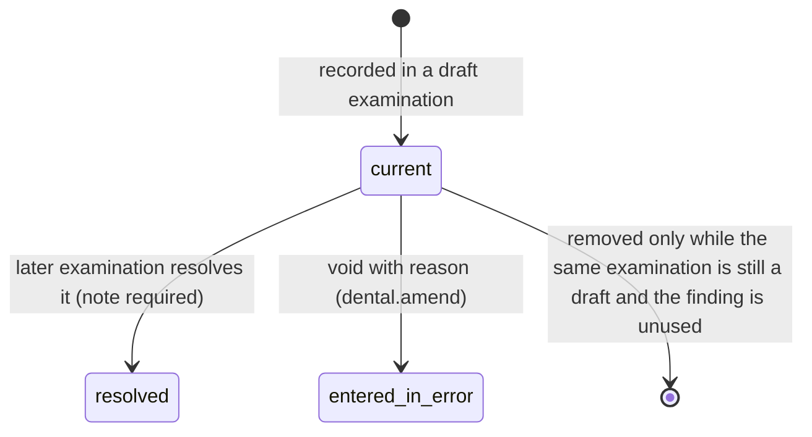
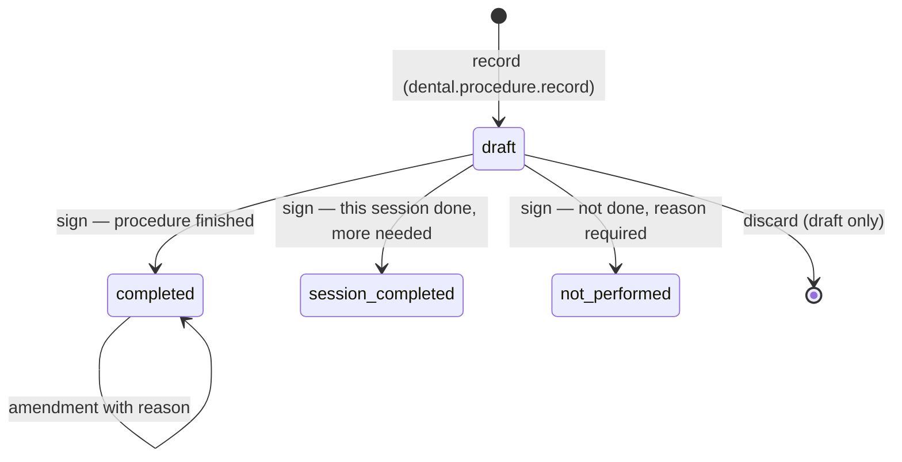

# Dental MRS — clinical workflows and state transitions

**Status: draft for dentist review.** Workflows follow the specification; real clinic practice may differ and
must be confirmed (review log R-01).

## A typical first visit (toothache)

1. **Reception** finds or registers the patient (shared registration, same MRN) and checks them in: walk-in, or
   an appointment of type *Toothache / urgent* on a dentist and chair.
2. **Dentist** opens the waiting list, clicks *Dental examination*. The visit becomes *In consultation*.
3. The examination opens on the **history** tab: the latest medical risk review and the shared allergies,
   conditions and medicines. The dentist confirms or records a new review.
4. **Complaint and pain**, then **extraoral and intraoral examination**.
5. **Chart**: tap a tooth, choose surfaces and a finding (e.g. 36 `DO` caries). The assistant may record findings
   the dentist calls out (`dental.chart.record`).
6. **Diagnosis** from the catalogue, linked to the tooth (e.g. K02.1 caries of dentine, 36 DO).
7. **Treatment plan**: add *Composite restoration, 2 surfaces* on 36 DO, present it, record the patient's decision.
8. **Procedure**: if done today, record it against the plan item, list materials, sign. The plan item is completed.
9. **Prescription** if needed (printed for an outside pharmacy if the clinic has no pharmacy module).
10. **Sign** the examination. The visit moves on to billing.
11. **Cashier** pulls charges: signed procedure records on this visit (and the consultation fee if the clinic
    bills one for dental visits). Payment, receipt.
12. **Recall**: the procedure's follow-up recommendation created a recall; reception books it from the recall list.
13. Reception completes the visit; anything still open is listed.

## Visit

The shared visit states are reused; the dental meaning is:

| Visit status | Dental meaning |
| --- | --- |
| Waiting for triage | Only if the clinic keeps the triage module on (off by default for dental) |
| Waiting for doctor | Waiting for the dentist |
| In consultation | In dental assessment or treatment (a draft dental examination exists) |
| After consultation | Examination signed; billing, imaging, prescriptions may continue |
| Completed | Closed by reception with an outcome |

"Treatment planned" and "Treatment in progress" are **plan** states, not visit states: a plan outlives the visit.

## Dental examination

```mermaid
stateDiagram-v2
    [*] --> draft : start (dental.write)
    draft --> draft : edit notes, chart, diagnoses, periodontal chart
    draft --> signed : sign (author only; needs complaint and diagnosis or assessment)
    signed --> signed : amendment with reason (dental.amend), chart correction with reason
```

## Chart findings

## Treatment plan

```mermaid
stateDiagram-v2
    [*] --> draft
    draft --> presented : present (≥1 item); revision snapshot
    presented --> accepted : patient decision, all items accepted
    presented --> partially_accepted : some accepted, others declined/deferred
    presented --> deferred : none accepted, some deferred
    presented --> declined : all declined
    deferred --> presented : present again
    accepted --> in_progress : first procedure signed on an item
    partially_accepted --> in_progress : first procedure signed on an item
    in_progress --> completed : every accepted item completed or cancelled
    draft --> cancelled
    presented --> cancelled
    accepted --> cancelled
    partially_accepted --> cancelled
    in_progress --> cancelled
    deferred --> cancelled
    presented --> expired
    deferred --> expired
```

The plan status is derived from its items after every change (`plans.derive_status`), except `draft`,
`cancelled` and `expired`, which are set explicitly. Revising a presented plan (adding, removing or re-pricing an
item) needs a reason and writes a revision snapshot; added items start as *proposed* and need the patient's
decision.

Item statuses: `proposed` → `accepted` / `declined` / `deferred`; `accepted` → `in_progress` (a session done) →
`completed` (a procedure record says completed); `proposed`/`accepted`/`deferred` → `cancelled` (reason).
A declined or deferred item stays visible on the plan and in reports; it can be accepted later.

The patient's acceptance is a record of the discussion. **It is not a consent form** (review log R-07).

## Procedure record

- The signer must be the person recorded as performing it and hold `dental.procedure.sign`; an assistant can
  prepare the record.
- At signing: price copied from the catalogue, materials deducted from stock (FEFO), plan item updated, follow-up
  recall created if recommended. `not_performed` deducts nothing and is never billable.
- Billable: `completed` always; `session_completed` only if the procedure's billing mode is `per_session`.

## Recall

`due` → `booked` (appointment made) → `completed` (the appointment was attended), or `postponed` (new due date),
`declined`, `unreachable` (after logged contact attempts), `cancelled`. A booked recall whose appointment is
cancelled or missed goes back to `due`.

## Dental laboratory case

`requested` → `in_progress` → `ready` → `delivered`; `cancelled` from any open state. The technician moves
their own cases from requested to ready; the dentist records delivery.

## Medical risk review

Recorded by the dentist before treatment and whenever the patient reports a change. The examination shows the
latest review, its date and who did it, and whether anything changed from the review before. No automatic
contraindication or "safe to treat" decision is made.
