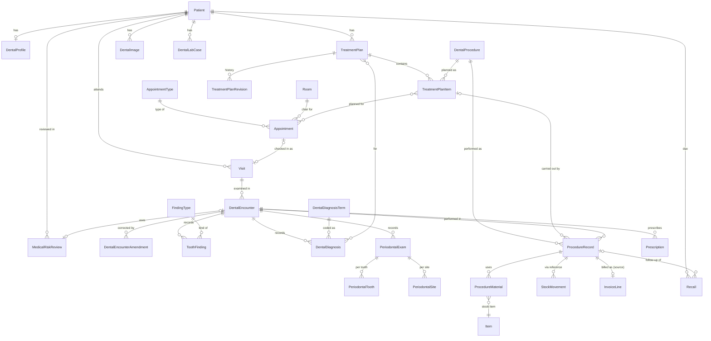

# Dental MRS — data model

**Status: draft for dentist review.** The structure is implemented; the clinical vocabularies seeded into it are
starter lists marked *pending clinical review* (see [clinical-review-log.md](clinical-review-log.md)).

All tables: UUID primary keys, `PROTECT` foreign keys, `created_at` / `updated_at` where mutable. Human-readable
numbers come from `core.numbering.next_number` (an atomic PostgreSQL upsert).

## Entity relationships

## Teeth, surfaces and regions (`apps/dental/teeth.py`)

- **Numbering:** FDI two-digit (ISO 3950). Permanent 11–18, 21–28, 31–38, 41–48. Primary 51–55, 61–65, 71–75, 81–85.
  Stored as a small integer and validated against that set; never free text.
- **Dentition** is derived from the number (quadrant 1–4 permanent, 5–8 primary). A mixed-dentition child simply
  has findings on both sets; the chart shows the teeth the patient has.
- **Surfaces:** `M` mesial, `D` distal, `O` occlusal (posterior teeth only), `I` incisal (anterior teeth only),
  `B` buccal/labial, `L` lingual/palatal. Stored as a sorted string of letters (`"DMO"`), validated per tooth type.
  Anterior = positions 1–3; posterior = positions 4–8 (permanent) and 4–5 (primary).
- **Scope** of a finding, diagnosis, plan item or procedure: `tooth`, `surfaces`, `region` or `mouth`.
  Regions: `q1`–`q4` (quadrants), `upper`, `lower` (arches), `sextant_1`–`sextant_6`.
  A database check constraint enforces that the fields set match the scope.

## Patient level

| Table | Purpose | Change rules |
| --- | --- | --- |
| `DentalProfile` | Previous dental treatment, extractions, root canal, orthodontic and prosthesis history, oral hygiene, tobacco and other habits, anxiety and communication needs | Editable (optimistic lock `row_version`); every change writes a `DentalProfileChange` row (field, old, new, who, when) and an audit event |
| `MedicalRiskReview` | Structured pre-treatment review: cardiovascular, diabetes, bleeding disorder or anticoagulants, immune condition, pregnancy, anaesthesia or dental-treatment reactions, surgeries and hospitalisations, other; each `yes` / `no` / `unknown` + detail; medication and allergy review confirmed | **Never edited.** A new review is recorded; `changed_since_previous` is computed at save time |

Allergies, known conditions and current medications are **not** copied: the review shows the shared patient
record (`patients.Allergy`, `Patient.known_conditions`, `Patient.current_medications`) and records that it was
checked. No contraindication rule is applied automatically.

## Dental examination

`DentalEncounter` — one dentist's clinical record of one consultation or treatment visit.

- `status`: `draft` → `signed` (`signed_at` set; check constraint). One draft per visit per dentist.
- Integer `version` for optimistic locking of note edits (same pattern as the medical `Encounter`).
- Note sections: chief complaint, history of the complaint, structured pain (present, teeth, location, severity
  0–10, onset, duration, pattern, triggers, relief, sensitivity to hot/cold/sweet/biting, swelling, the patient's
  own words), medical and dental history review, extraoral findings (symmetry, swelling, lymph nodes, jaw movement,
  TMJ, mouth opening mm), intraoral findings (mucosa, tongue, floor of mouth, palate, gingiva, saliva, occlusion,
  soft tissue lesions, other), assessment, proposed treatment, discussion with the patient, consent notes,
  follow-up instructions and date.
- Signing needs a chief complaint and either a diagnosis or an assessment. After signing nothing on the
  examination, its findings, diagnoses or periodontal charts can be edited; corrections are
  `DentalEncounterAmendment` rows (field, original, amended, reason, author) or chart corrections (below).

## Odontogram — dated findings (ADR 0006)

`ToothFinding` — one statement about a tooth, surfaces, region or the whole mouth, made in one examination.

| Field | Meaning |
| --- | --- |
| `encounter`, `patient`, `recorded_by`, `recorded_at` | Who stated it, when, in which examination |
| `scope`, `tooth`, `surfaces`, `region` | Where (validated as above) |
| `finding_type` | From the configurable `FindingType` vocabulary; its `kind` is `state` (missing, unerupted…), `condition` (caries, fracture…), `existing` (restoration, crown, root canal treated…) |
| `is_existing_work` | Copied from the type at recording: prior treatment vs current pathology, shown differently on the chart |
| `diagnosis`, `procedure` | Optional links |
| `resolved_at`, `resolved_in`, `resolved_by`, `resolution_note` | Set once, by a later examination, when the finding no longer applies (e.g. caries restored, tooth extracted) |
| `voided_at`, `voided_by`, `void_reason` | Set once, with `dental.amend`, when the finding was entered in error |

The chart **as of time T** = findings recorded at or before T, not voided, and not resolved at or before T. The
current chart is the same query at "now". Nothing is overwritten: changing a tooth's state is a new finding plus
the resolution of the old one, both visible in the tooth's history.

## Periodontal examination

- `PeriodontalExam`: patient, encounter, examiner, protocol (`six_site`), plaque/bleeding notes, created and
  updated times. Editable only while its examination is a draft.
- `PeriodontalTooth`: per tooth — `missing`, `excluded` (+ reason), `implant`, mobility 0–3, furcation 0–3
  (only on teeth that can have a furcation: molars and maxillary first premolars).
- `PeriodontalSite`: per tooth × site (`MB`, `B`, `DB`, `ML`, `L`, `DL`) — probing depth mm (0–15), gingival
  margin mm (−10 to 15), bleeding on probing, plaque, suppuration, `not_measured` (+ reason). Unique per
  exam/tooth/site; check constraints on ranges; a site marked not measured cannot carry values.
- **Calculated, never stored:** clinical attachment level = probing depth + gingival margin, using the convention
  *gingival margin measured from the CEJ, positive when the margin is apical to the CEJ (recession), negative when
  coronal*. Percent sites bleeding and with plaque are over **measured** sites only and report how many sites were
  measured. Pending dentist confirmation of the convention (review log item R-04).

## Diagnoses

- `DentalDiagnosisTerm` catalogue: `code_system`, `code`, `term`, `category`, `source_version`, `is_active`,
  `review_status`. Seeded with WHO ICD-10 codes from chapter XI (K00–K14) and S02.5, which the system already uses
  for medical diagnoses. No proprietary codes; no SNODENT claim.
- `DentalDiagnosis`: encounter, patient, a **copy** of code system, code, term and source version at the time of
  recording, scope/tooth/surfaces/region, `certainty` (`suspected`, `confirmed`), `status` (`active`,
  `historical`, `resolved`), notes. Removed only while the examination is a draft; resolved later with a note.

## Treatment plans

- `TreatmentPlan` (`row_version`): number `TP-YYYY-NNNNN`, patient, created by, origin encounter, title and
  clinical reason, linked diagnoses, status, revision number, review date, presented/decision times, notes.
- `TreatmentPlanItem`: sequence, procedure, scope/tooth/surfaces/region, diagnosis, priority, sessions planned,
  estimated minutes, **estimated fee copied from the catalogue when added**, assigned dentist, notes, status,
  planned appointments (many-to-many to `Appointment`).
- `TreatmentPlanRevision`: a full JSON snapshot of the plan and items each time it is presented and each time it
  changes after presentation, with author, time and reason. The original proposal is always revision 1.

Plan statuses and item statuses are in [clinical-workflows.md](clinical-workflows.md#treatment-plan). An item is
*completed* only by a signed procedure record that says so — never by booking an appointment or issuing an invoice.

## Procedures

- `DentalProcedure` catalogue: code, name, category, description, default minutes, **price**, tax rate, active,
  tooth requirement (`required` / `optional` / `none`), surfaces allowed, consumes stock, typical sessions,
  billing mode (`on_completion` or `per_session`), follow-up recommendation (kind and days), the roles allowed
  to perform it (empty = anyone with `dental.procedure.sign`), default materials.
- `ProcedureRecord`: number `PR-YYYY-NNNNN`, patient, visit, encounter, plan item, procedure, scope/tooth/surfaces/
  region, performed by, assisted by, session number, started/completed times, findings before/after, notes,
  anaesthesia (free text written by the dentist), complications, post-operative instructions, follow-up
  recommendation, status (`draft`, `completed`, `session_completed`, `not_performed`), not-performed reason,
  `signed_at` / `signed_by`, `price` (copied at signing).
- `ProcedureMaterial`: item and quantity. **Stock is deducted at signing**, through `inventory.allocate_fefo`, with
  `reference_type="dental_procedure"`. Draft materials touch no stock, so nothing needs reversing.
- `ProcedureAmendment`: corrections to a signed record.
- Database guarantees: one `completed` record per plan item; billing line source `("dental_procedure", id)` is
  unique among live invoice lines (existing constraint), so a procedure is never billed twice.

## Prescriptions (shared)

`clinical.Prescription` gains `visit` (always set) and `dental_encounter`; `encounter` becomes optional. A check
constraint requires exactly one of `encounter` / `dental_encounter`. Pharmacy, billing and visit completion now
follow `visit`, so dental prescriptions are dispensed, billed and closed exactly like medical ones; without the
pharmacy module they are printed for an outside pharmacy (status `external`). See ADR 0009.

## Imaging (ADR 0007)

`DentalImage`: patient, visit, encounter, image type, captured at, uploaded at/by, referring dentist, teeth (array)
or region, description, original file name, content type, size, SHA-256, width and height, opaque storage key and
preview key, status (`active` / `withdrawn`), withdrawal reason, `replaces` (the image this one corrects).
`DentalImageChange` records every metadata correction (field, old, new, who, when, reason). Bytes live in files,
never in the row.

## Recalls and laboratory cases

- `Recall`: patient, kind (post-operative review, root canal continuation, crown/bridge fitting, periodontal
  review, orthodontic adjustment, preventive recall, other), due date, note, source procedure/encounter, status
  (`due`, `booked`, `completed`, `postponed`, `declined`, `unreachable`, `cancelled`), appointment;
  `RecallContact` rows log every contact attempt.
- `DentalLabCase`: number `LC-YYYY-NNNNN`, patient, plan item, case type, teeth, shade, instructions, assigned
  technician, due date, status (`requested`, `in_progress`, `ready`, `delivered`, `cancelled`); `DentalLabCaseEvent`
  rows are the case history. A technician sees only the patient's name and MRN and only cases assigned to them.

## Shared tables extended

- `scheduling.AppointmentType`: name, code, default minutes, default chair (room), category
  (`consultation` / `procedure` / `review` / `imaging`), active. `Appointment` gains `appointment_type` and `room`
  (the chair). Booking refuses an overlap for the same dentist (as before) **and** the same chair.
- `inventory.Item`: categories widened for dental supplies (restorative, anaesthetic, endodontic, impression,
  prosthetic, sterilisation, infection control, instrument); `pack_unit` and `units_per_pack` for package
  conversion. Items in the *instrument* category cannot be recorded as consumed by a procedure.
- `core.ClinicSettings.bill_consultation_for_dental` (default off): dental visits are billed by procedure; when
  on, the clinic's consultation fee is also added for a visit with a dental examination.
